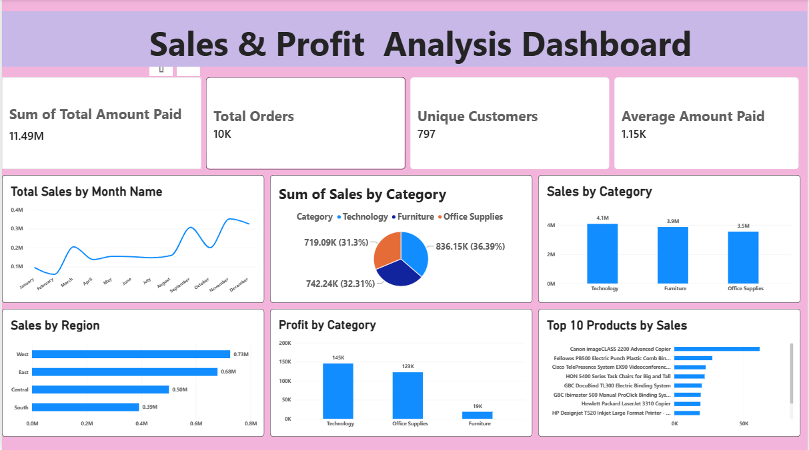

# 📊 Sample Superstore Sales & Profit Analysis – Power BI

## 📌 Project Overview

This project is an interactive **Sales & Profit Analysis Dashboard** created using **Microsoft Power BI** and the Sample Superstore dataset.

The dashboard provides insights into sales performance, profitability, regional performance, category performance, monthly sales trends, and top-performing products.

---

## 🛠️ Tools & Technologies

- Microsoft Power BI
- DAX
- Power Query
- Data Visualization
- Data Analysis
- Sample Superstore Dataset

---

## 📊 Dashboard KPIs

| KPI | Value |
|---|---:|
| **Total Sales** | 11.49M |
| **Total Orders** | 10K |
| **Unique Customers** | 797 |
| **Average Amount Paid** | 1.15K |

---

## 📈 Dashboard Analysis

### 1. Sales by Month
Analyzed the monthly sales trend to understand changes in sales throughout the year.

### 2. Sales by Category
Compared sales performance across:
- Technology
- Furniture
- Office Supplies

### 3. Sales by Region
Analyzed sales performance across:
- West
- East
- Central
- South

### 4. Profit by Category
Compared profitability across different product categories.

### 5. Top 10 Products by Sales
Identified the top-performing products based on sales.

---

## 💡 Key Insights

- Technology generated the highest sales among the major categories.
- The West region recorded the highest sales among the displayed regions.
- Technology generated the highest profit among the categories.
- Sales varied throughout the year, with noticeable monthly fluctuations.
- The Top 10 Products analysis highlights the products contributing significantly to overall sales.

---

## 🖼️ Dashboard Preview



---

## 📂 Project Structure

```text
Sample-Superstore-PowerBI/
│
├── Sample-Superstore-PowerBI.pbix
├── README.md
└── screenshots/
    └── dashboard.png
