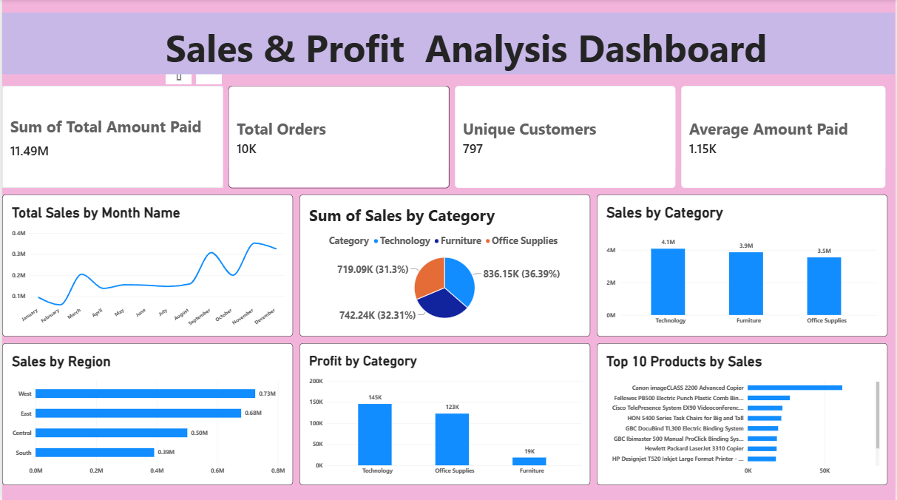

# 📊 Sample Superstore Sales & Profit Analysis – Power BI

## 📌 Project Overview

This project presents an interactive **Sales & Profit Analysis Dashboard** built using **Microsoft Power BI** with the Sample Superstore dataset.

The dashboard focuses on understanding sales performance, profitability, customer volume, regional performance, category performance, monthly trends, and top-performing products.

## 🛠️ Tools & Technologies

- **Microsoft Power BI**
- **DAX**
- **Power Query**
- **Sample Superstore Dataset**
- **Data Visualization & Business Intelligence**

## 📈 Dashboard Overview

The dashboard contains the following key metrics and visualizations:

### Key Performance Indicators (KPIs)

- **Total Sales:** 11.49M
- **Total Orders:** 10K
- **Unique Customers:** 797
- **Average Amount Paid:** 1.15K

### Analysis Included

- **Total Sales by Month** – Monthly sales trend
- **Sales by Category** – Comparison of Technology, Furniture, and Office Supplies
- **Sales by Region** – Regional sales performance
- **Profit by Category** – Profitability across product categories
- **Top 10 Products by Sales** – Highest-selling products

## 💡 Key Dashboard Observations

- Technology has the highest sales among the three major categories.
- The West region has the highest sales among the displayed regions.
- Technology also contributes the highest category-level profit.
- Monthly sales show noticeable variation throughout the year.
- The dashboard highlights the products contributing most to overall sales.

> These observations are based on the data represented in the Power BI dashboard and are intended for portfolio/demo purposes.

## 🖼️ Dashboard Preview



## 📂 Project Structure

```text
Sample-Superstore-PowerBI/
│
├── Sample-Superstore-PowerBI.pbix
├── README.md
└── screenshots/
    └── dashboard.png
```

## ▶️ How to Use

1. Download or clone this repository.
2. Open `Sample-Superstore-PowerBI.pbix` using **Microsoft Power BI Desktop**.
3. Interact with the report visuals to explore the sales and profit analysis.

## 🎯 Skills Demonstrated

- Data Analysis
- Data Visualization
- Power BI Dashboard Development
- DAX Measures
- KPI Creation
- Trend Analysis
- Category Analysis
- Regional Analysis
- Product Performance Analysis
- Business Reporting

## 👤 Author

**Kandula Nithin Reddy**

- GitHub: [KandulaReddy0602](https://github.com/KandulaReddy0602)
- Role: Data Analyst

---

⭐ If you find this project useful, feel free to explore the other projects in my portfolio.
